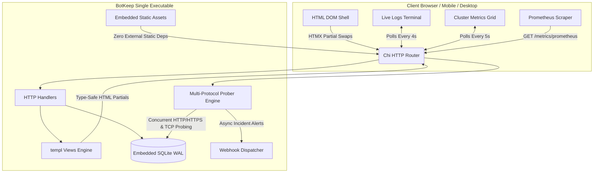

<div align="center">

# BotKeep

### Enterprise Multi-Protocol DevOps Fleet Management & Observability Dashboard

[](https://golang.org)
[](https://htmx.org)
[](https://tailwindcss.com)
[](https://github.com/sky-ruler/botkeep/actions/workflows/ci.yml)
[](https://opensource.org/licenses/MIT)
[](https://github.com/sky-ruler/botkeep)
[-blue)](https://github.com/sky-ruler/botkeep)
[](https://github.com/sky-ruler/botkeep)

<p align="center">
  <b>Bypass JavaScript SPA bloat.</b> BotKeep delivers an ultra-fast, single-executable DevOps fleet dashboard combining <b>Go</b>, <b>HTMX</b>, <b>templ</b>, and <b>Tailwind CSS</b> with embedded pure-Go SQLite.
</p>

[Quickstart](#-quickstart) • [Explained (ELI5 to Pro)](docs/EXPLAINED.md) • [Architecture](docs/ARCHITECTURE.md) • [API Reference](docs/API.md) • [USP & Roadmap](docs/ROADMAP_USP.md) • [Features](#-key-features) • [Configuration](#-configuration)

---

</div>

## 👶 Simple English Summary (What is BotKeep?)

> 📘 **Want the complete breakdown? Read [BotKeep Explained: From Beginner to DevOps Pro](docs/EXPLAINED.md).**

Think of BotKeep as a **24/7 personal doctor for your websites, databases, and microservices**:
- **Multi-Protocol Health Checks**: Pings HTTP/HTTPS, dials TCP sockets, executes native `grpc.health.v1` probes, and audits DNS resolution.
- **SSL/TLS & Domain Intelligence**: Intercepts TLS handshakes to extract Certificate Authority, Common Name, SANs, and countdown to expiration.
- **Automated Self-Healing Runbooks**: Dispatches automated remediation webhooks (GitHub Actions, Docker restarts, Kubernetes rollouts) to fix outages before escalating to humans.
- **Declarative GitOps Mode (`fleet.yaml`)**: Manage your entire monitoring infrastructure as code (`botkeep export-fleet` / `botkeep -fleet fleet.yaml`).
- **Zero-Config Satellite Mesh**: Deploy edge satellites (`botkeep agent`) with multi-region consensus shields to eliminate false alarms.
- **Instant Public Status Page (`/status`)**: Zero-cost public uptime dashboard with incident reporting and markdown updates.
- **1-Click Push Alerts**: Pre-integrated push delivery for Discord, Slack, Telegram, and ntfy.sh with zero glue code.
- **Works on Any Screen**: 100% responsive layout with mobile drawer navigation, responsive grids, and scrollable data tables.
- **Zero Bloat / Zero Setup**: No separate database (MySQL/Postgres) and no Node.js needed. A single, self-contained executable file that starts in under 4 milliseconds.

---

## 📸 Overview & Design Aesthetics

BotKeep follows a strict **Linear / Vercel** dark mode design language (`bg-zinc-950` canvas, `bg-zinc-900` surfaces, `border-zinc-800` subtle dividers, and `Inter` typography).

```
+---------------------------------------------------------------------------------------------------+
|  BotKeep v2.0   |  linux/amd64 / edge-node-01  [Active Engine]           [Prometheus] [Export JSON] |
+-----------------+---------------------------------------------------------------------------------+
|  [>] Fleet      |  +-------------+  +-------------+  +-------------+  +-------------+             |
|  [*] Metrics    |  | Capacity    |  | Avg Latency |  | Fleet SLA   |  | Heap Memory |             |
|  [_] Telemetry  |  | 5 / 5       |  | 32.4ms      |  | 99.8%       |  | 14.2 MB     |             |
|                 |  +-------------+  +-------------+  +-------------+  +-------------+             |
|  Cluster Status |                                                                                 |
|  (*) Healthy    |  [Search Targets...        ] [Status: All v] [Region: All v]  [+ Deploy Target] |
|                 |  +----------------------------------------------------------------------------+ |
|  Go Runtime     |  | Node / Target       | Driver & Protocol | Status   | Latency & SLA | Actions   | |
|  Single-Binary  |  | cloudflare-cdn-edge | HTTP [HTTPS][SSL] | (o) Live | 39.4ms [||||] | [Ping]... | |
|                 |  | postgres-cluster-pri| TCP  [TCP]         | (o) Live | 1.2ms  [||||] | [Ping]... | |
|                 |  | github-api-gateway  | HTTP [HTTPS][SSL] | (o) Live | 65.1ms [||||] | [Ping]... | |
|                 |  +----------------------------------------------------------------------------+ |
|                 |                                                                                 |
|                 |  Live Orchestration Logs [(*) Streaming]                          [Clear Buffer]| |
|                 |  +----------------------------------------------------------------------------+ |
|                 |  | 03:04:12 [PROBE] [github-api-gateway] HTTP 200 OK (65.1ms) - SLA: 100.0%   | |
|                 |  | 03:04:28 [INFO]  WAL auto-checkpoint executed (zero lock contention)       | |
|                 |  | 03:04:55 [DEPLOY][postgres-cluster-pri] TCP port 5432 verified reachable   | |
|                 |  +----------------------------------------------------------------------------+ |
+-----------------+---------------------------------------------------------------------------------+
```

---

## 🎯 Why BotKeep?

Modern DevOps dashboards often ship with hundreds of megabytes of client-side node_modules, complex state stores, and heavyweight Electron or SPA runtimes.

| Metric | Traditional Node / React Dashboard | **BotKeep Single-Binary** |
| :--- | :--- | :--- |
| **Executable Size** | 150 MB - 300 MB (with node runtime) | **~12 MB (Self-contained binary)** |
| **Idle Memory (RAM)** | 180 MB - 450 MB | **< 18 MB** |
| **Cold Start Time** | 2,500 ms - 4,000 ms | **< 4 ms** |
| **External Dependencies** | Node.js, npm, Webpack/Vite runtime | **Zero (Embeds CSS, JS, & SQLite)** |
| **Interactivity Model** | Client Virtual DOM re-renders | **HTMX Targeted Server DOM Swaps** |
| **Type Safety** | TypeScript (compile-time only) | **Go + `a-h/templ` (Type-safe HTML)** |
| **Multi-Screen Support** | Often desktop-only or cramped | **100% Responsive (Mobile drawer to 4K)** |

---

## 🧱 Architecture

BotKeep bypasses the SPA paradigm using **HTMX** and **a-h/templ**. All static assets (Tailwind CSS, HTMX script) and database schemas are bundled directly into the compiled executable via Go's `//go:embed`.



---

## ✨ Key Features

- **⚡ Instant Single-Binary Launch**: Zero external database setup, Node.js runtime, or Docker requirements to run. Single ~12 MB self-contained binary.
- **📡 Multi-Protocol Health Probing**:
  - **HTTP & HTTPS**: Real HTTP requests, status code validation, and automatic TLS peer certificate extraction.
  - **TCP Socket**: Direct port connectivity prober for databases (PostgreSQL, MySQL, Redis, SSH, Kafka).
  - **Simulated Node**: Organic jitter simulation for sandbox testing.
- **🔒 TLS / SSL Certificate Expiry Auditing**: Intercepts `resp.TLS.PeerCertificates` and tracks days remaining until expiration (`ssl_expiry_days`) directly in the UI and Prometheus metrics.
- **📢 Zero-Cost Public Status Page (`/status`)**: Customer-facing live status page with real-time operational banners, 90-day incident/maintenance timelines, public component isolation, and CORS-enabled `/api/status` JSON feed. Eliminates $50–$200/mo third-party SaaS hosting costs.
- **🔔 1-Click Multi-Channel Push Notifications (`/notifications`)**: Zero-glue delivery presets for **Discord** (rich embeds), **Telegram** (Bot API HTML formatting), **Slack** (attachment blocks), **ntfy.sh** (free instant mobile phone push without account), and custom **Webhooks**. Includes 1-click test pings and broadcast testing.
- **📊 Native Prometheus / OpenMetrics Exposition**: Native `/metrics/prometheus` endpoint exposing target status, latency, SLA, SSL days, and Go runtime memory/goroutines.
- **💾 Fleet Configuration JSON Backup**: 1-click `/api/fleet/export` endpoint to download complete fleet definitions as an indented JSON backup file.
- **🚨 Incident Webhook Alerting**: Configurable `BOTKEEP_WEBHOOK_URL` to dispatch async JSON notifications on outages (`INCIDENT_DOWN`) and recoveries (`INCIDENT_RESOLVED`).
- **📱 100% Responsive for All Screen Sizes**:
  - Dedicated mobile drawer navigation (`md:hidden`) with blurred backdrop.
  - Adaptive 1-col to 4-col metrics grids.
  - Fluid slide-over telemetry inspector drawer.
  - Horizontal scroll protection for high-density tables.
- **⚡ Instant On-Demand "Ping Now" Checks**: Click the **Ping** action on any node to fire an instant HTTP/TCP probe and update row telemetry via targeted HTMX swaps.
- **🔄 Localized HTMX Swaps**: Triggering **Start**, **Stop**, or **Restart** updates *only* that specific table row with targeted spinners (`hx-indicator`) and disables clicked elements (`hx-disabled-elt`) to prevent double-clicks.
- **🔍 Instant Fleet Search & Multi-Filter**: Search nodes by name, ID, IP, or endpoint URL in real time with debounced HTMX requests (`delay:250ms`), filtered by status and availability zone.
- **📂 Deep Node Telemetry Drawer**: Click on any node to slide open a dedicated telemetry panel showing CPU, RAM, Latency, SLA gauges, TLS expiry, and node audit trails.
- **🛡️ Non-Intrusive Error Toasts**: Network hiccups or 500 exceptions trigger toast notifications through client-side HTMX event listeners without corrupting the DOM.
- **📈 Real Go Host Telemetry**: Live Go runtime metrics including goroutine count, allocated heap memory, garbage collection passes, OS architecture, and thread allocations.

---

## 🚀 Quickstart

### Option 1: 1-Line Zero-Dependency Installer (Linux / macOS / WSL)
Installs the precompiled native executable directly into `/usr/local/bin` or `~/.local/bin`:
```bash
curl -fsSL https://raw.githubusercontent.com/sky-ruler/botkeep/main/install.sh | bash
```

### Option 2: Run the Precompiled Binary
Download the prebuilt single binary for your operating system from [GitHub Releases](https://github.com/sky-ruler/botkeep/releases):
```bash
# Run locally with demo fleet
./botkeep -seed

# Open http://localhost:8080 in your browser
```

### Option 3: Run via Docker Compose
```bash
docker compose up -d
# Dashboard available at http://localhost:8080
```

### Option 4: Build from Source
```bash
# 1. Clone repository
git clone https://github.com/sky-ruler/botkeep.git
cd botkeep

# 2. Install dependencies & tools
npm install
go install github.com/a-h/templ/cmd/templ@v0.3.833

# 3. Build & Run (Cross-Platform)
# On Linux / macOS:
make run

# On Windows PowerShell:
.\build.ps1 -Target run
```

---

## ⚙️ Configuration & Security

BotKeep is configured via command-line flags and environment variables:

| Flag | Env Variable | Default | Description |
| :--- | :--- | :--- | :--- |
| `-port` | `PORT` | `8080` | TCP port for HTTP server |
| `-db` | `BOTKEEP_DB_PATH` | `botkeep.db` | Path to embedded SQLite database |
| `-interval` | `BOTKEEP_PROBE_INTERVAL` | `15s` | Interval between background fleet probe cycles |
| `-fleet` | `BOTKEEP_FLEET_FILE` | `""` | Path to declarative GitOps `fleet.yaml` manifest |
| `-auth-user` | `BOTKEEP_AUTH_USER` | `""` | Administrative HTTP Basic Auth username |
| `-auth-pass` | `BOTKEEP_AUTH_PASS` | `""` | Administrative HTTP Basic Auth password |
| `-api-key` | `BOTKEEP_API_KEY` | `""` | Bearer Token / `X-API-Key` for administrative API endpoints |
| — | `BOTKEEP_WEBHOOK_URL` | `""` | Optional HTTP URL for downtime incident webhooks |

### 🔒 Public vs. Authenticated Endpoints
When `-auth-user`/`-auth-pass` or `-api-key` is configured, BotKeep automatically protects administrative control plane routes while keeping public observability feeds open:

- **Public Endpoints (Zero Auth Required)**:
  - `/status` — Public Status Page & real-time SLA uptime dashboard
  - `/status/components` — Partial HTMX component telemetry feed
  - `/api/status` — Machine-readable incident & service health JSON feed
  - `/healthz` — Container orchestrator liveness probe (`200 OK`)
  - `/metrics/prometheus` — OpenMetrics / Prometheus scrape endpoint
  - `/static/*` — Embedded CSS & script assets
- **Protected Endpoints (Basic Auth or API Key Required)**:
  - `/` & `/servers/*` — Dashboard, node actions, synthetic probing rules, runbooks
  - `/admin/*` — Incident creation, notification channel management
  - `/notifications/*` — Alert destination configuration & dispatch test firing
  - `/api/fleet/*` — Fleet export & GitOps schema synchronization
  - `/api/satellites` & `/api/satellite/*` — Multi-region consensus mesh telemetry

---

## 📊 Prometheus Scrape Configuration

To scrape BotKeep from your `prometheus.yml`:

```yaml
scrape_configs:
  - job_name: "botkeep"
    scrape_interval: 10s
    static_configs:
      - targets: ["localhost:8080"]
    metrics_path: "/metrics/prometheus"
```

---

## 📜 License

Distributed under the MIT License. See [LICENSE](LICENSE) for more information.

