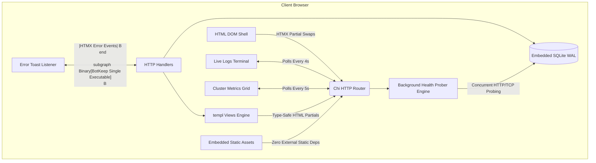

<div align="center">

# ⚡ BotKeep

### High-Performance, Single-Binary DevOps Server Management Dashboard

[](https://golang.org)
[](https://htmx.org)
[](https://tailwindcss.com)
[](https://github.com/sky-ruler/botkeep/actions/workflows/ci.yml)
[](https://opensource.org/licenses/MIT)
[](https://github.com/sky-ruler/botkeep)
[-blue)](https://github.com/sky-ruler/botkeep)

<p align="center">
  <b>Bypass JavaScript SPA bloat.</b> BotKeep delivers an ultra-fast, single-executable DevOps fleet dashboard combining <b>Go</b>, <b>HTMX</b>, <b>templ</b>, and <b>Tailwind CSS</b> with embedded pure-Go SQLite.
</p>

[Quickstart](#-quickstart) • [Explained (ELI5 to Pro)](docs/EXPLAINED.md) • [Architecture](docs/ARCHITECTURE.md) • [API Reference](docs/API.md) • [Features](#-key-features) • [Configuration](#-configuration) • [Benchmarks](#-resource-footprint--benchmarks)

---

</div>

## 👶 Simple English Summary (What is BotKeep?)

> 📘 **Want the complete breakdown? Read [BotKeep Explained: From Beginner to DevOps Pro](docs/EXPLAINED.md).**

Think of BotKeep as a **24/7 personal doctor for your websites and servers**:
- **Checks the Pulse**: Every 15 seconds, it pings your web apps and APIs to make sure they are healthy.
- **Measures Speed**: Tells you exactly how fast they respond in milliseconds.
- **Tracks Reliability (SLA)**: Calculates your real uptime percentage over time.
- **Zero Bloat / Zero Setup**: No separate database (MySQL/Postgres) and no Node.js needed. It is a single, self-contained executable file that runs in under 4 milliseconds.

---

## 📸 Overview & Design Aesthetics

BotKeep follows a strict **Linear / Vercel** dark mode design language (`bg-zinc-950` canvas, `bg-zinc-900` surfaces, `border-zinc-800` subtle dividers, and `Inter` typography).

```
+---------------------------------------------------------------------------------------------------+
|  BotKeep v2.0   |  linux/amd64 / edge-node-01  [Node Engine]                 [Seed Demo Fleet]    |
+-----------------+---------------------------------------------------------------------------------+
|  [>] Fleet      |  +-------------+  +-------------+  +-------------+  +-------------+             |
|  [*] Metrics    |  | Capacity    |  | Avg Latency |  | Fleet SLA   |  | Heap Memory |             |
|  [_] Telemetry  |  | 5 / 5       |  | 32.4ms      |  | 99.8%       |  | 14.2 MB     |             |
|                 |  +-------------+  +-------------+  +-------------+  +-------------+             |
|  Cluster Status |                                                                                 |
|  (*) Healthy    |  [Search Nodes...          ] [Status: All v] [Region: All v]  [+ Deploy Node  ] |
|                 |  +----------------------------------------------------------------------------+ |
|  Go Runtime     |  | Node / Instance     | Driver   | Status   | Latency & SLA   | Actions      | |
|  Single-Binary  |  | api.github.com      | HTTP     | (o) Live | 32.4ms [||||||] | [Ping][Stop] | |
|                 |  | auth-service-01     | Demo     | (o) Live | 24.8ms [||||||] | [Ping][Stop] | |
|                 |  | worker-queue-node   | Demo     | (x) Stop | 0.0ms  [......] | [Ping][Start]| |
|                 |  +----------------------------------------------------------------------------+ |
|                 |                                                                                 |
|                 |  Live Orchestration Logs [(*) Streaming]                          [Clear Buffer]| |
|                 |  +----------------------------------------------------------------------------+ |
|                 |  | 03:04:12 [PROBE] [api.github.com] HTTP 200 OK (32.4ms) - SLA: 100.0%       | |
|                 |  | 03:04:28 [INFO]  WAL auto-checkpoint executed (zero lock contention)       | |
|                 |  | 03:04:55 [DEPLOY][api.github.com] Provisioned (Driver: http)               | |
|                 |  +----------------------------------------------------------------------------+ |
+-----------------+---------------------------------------------------------------------------------+
```

---

## 🎯 Why BotKeep?

Modern DevOps dashboards often ship with hundreds of megabytes of client-side node_modules, complex state stores, and heavyweight Electron or SPA runtimes.

| Metric | Traditional Node / React Dashboard | **BotKeep Single-Binary** |
| :--- | :--- | :--- |
| **Executable Size** | 150 MB - 300 MB (with node runtime) | **~12 MB (Self-contained binary)** |
| **Idle Memory (RAM)** | 180 MB - 450 MB | **< 18 MB** |
| **Cold Start Time** | 2,500 ms - 4,000 ms | **< 4 ms** |
| **External Dependencies** | Node.js, npm, Webpack/Vite runtime | **Zero (Embeds CSS, JS, & SQLite)** |
| **Interactivity Model** | Client Virtual DOM re-renders | **HTMX Targeted Server DOM Swaps** |
| **Type Safety** | TypeScript (compile-time only) | **Go + `a-h/templ` (Type-safe HTML)** |

---

## 🧱 Architecture

BotKeep bypasses the SPA paradigm using **HTMX** and **a-h/templ**. All static assets (Tailwind CSS, HTMX script) and database schemas are bundled directly into the compiled executable via Go's `//go:embed`.



---

## ✨ Key Features

- **⚡ Instant Single-Binary Launch**: Zero external database setup, Node.js runtime, or Docker requirements to run. Single ~12 MB self-contained binary.
- **📡 Active HTTP & API Health Probing**: Pluggable driver engine (`http`, `system`, `demo`) that continuously probes endpoints in the background, measuring sub-millisecond precision latency and HTTP status codes.
- **📊 Rolling Uptime SLA Tracking**: Real-time SLA % calculation with visual spark dots and history inspection for auditing incident response.
- **⚡ Instant On-Demand "Ping Now" Checks**: Click the **Ping** action on any node to fire an instant HTTP probe and update row telemetry via targeted HTMX swaps.
- **🔄 Localized HTMX Swaps**: Triggering **Start**, **Stop**, or **Restart** updates *only* that specific table row with targeted spinners (`hx-indicator`) and disables clicked elements (`hx-disabled-elt`) to prevent double-clicks.
- **🔍 Instant Fleet Search & Multi-Filter**: Search nodes by name, ID, IP, or endpoint URL in real time with debounced HTMX requests (`delay:250ms`), filtered by status and availability zone.
- **📂 Deep Node Telemetry Drawer**: Click on any node to slide open a dedicated telemetry panel showing CPU, RAM, Latency, and SLA gauges, probe history log, and node audit trails.
- **🛡️ Non-Intrusive Error Toasts**: Network hiccups or 500 exceptions trigger toast notifications through client-side HTMX event listeners without corrupting the DOM.
- **📈 Real Go Host Telemetry**: Live Go runtime metrics including goroutine count, allocated heap memory, garbage collection passes, OS architecture, and thread allocations.
- **🌐 Real DNS Resolution & Rolling SLA**: Zero hardcoded metrics. Real HTTP targets resolve public IP addresses via DNS (`net.LookupIP`), with SLA calculated from live probe history.
- **🪹 Polished Empty State**: Empty database instances render an illustrative empty state with 1-click **Deploy Demo Fleet** action.

---

## 🚀 Quickstart

### Option 1: Run the Precompiled Binary
Download the prebuilt single binary for your operating system from GitHub Releases:
```bash
# Run locally
./botkeep

# Open http://localhost:8080 in your browser
```

### Option 2: Run via Docker Compose
```bash
docker compose up -d
# Dashboard available at http://localhost:8080
```

### Option 3: Build from Source
```bash
# 1. Clone repository
git clone https://github.com/sky-ruler/botkeep.git
cd botkeep

# 2. Install dependencies & tools
npm install
go install github.com/a-h/templ/cmd/templ@v0.3.833

# 3. Build & Run (Cross-Platform)
# On Linux / macOS:
make run

# On Windows PowerShell:
.\build.ps1 -Target run
```

---

## ⚙️ Configuration

BotKeep is configured via command-line flags or environment variables:

| Flag | Environment Variable | Default | Description |
| :--- | :--- | :--- | :--- |
| `-port` | `PORT` | `8080` | HTTP listening port |
| `-db` | `DB_PATH` | `botkeep.db` | SQLite database file location |
| `-interval` | `PROBE_INTERVAL` | `15s` | Fleet health check probe sweep interval |
| `-seed` | `SEED_FLEET` | `false` | Force re-seed default demo servers on startup |
| `-version`| — | — | Print version and runtime details and exit |

Example:
```bash
./botkeep -port 3000 -db /var/data/fleet.db -interval 10s
```


---

## 🧪 Testing & Validation

BotKeep includes unit and integration tests covering the database layer, state machine transitions, search filters, and HTTP handlers:

```bash
# Run unit & integration test suite
go test -v -race ./...

# Verify code formatting
go fmt ./...
templ fmt .
```

---

## 📦 Project Structure

```
BotKeep/
├── cmd/server/main.go            # Entrypoint, Chi router, static asset server, graceful shutdown
├── internal/
│   ├── handlers/                 # HTTP handlers returning compiled templ components
│   │   ├── handlers.go
│   │   └── handlers_test.go      # HTTP router & HTMX integration tests
│   ├── models/                   # SQLite schema, queries, metrics & state transitions
│   │   ├── schema.sql            # Embedded SQLite schema
│   │   ├── models.go
│   │   └── models_test.go        # Database unit test suite
│   └── monitor/                  # Concurrent health prober engine & SLA tracking
│       ├── monitor.go
│       └── monitor_test.go       # Mock HTTP & driver prober test suite
├── views/
│   ├── components/               # Atomic templ components
│   │   ├── badge.templ           # Status badges (Active, Stopped, Deploying)
│   │   ├── button.templ          # Primary, Secondary & HTMX Action buttons
│   │   ├── card.templ            # Telemetry metric cards & gauges
│   │   ├── empty.templ           # Empty state with SVG illustration & CTA
│   │   ├── icons.templ           # Lucide SVG atomic components
│   │   ├── skeleton.templ        # Localized loading skeleton loaders
│   │   └── toast.templ           # Floating toast notification component
│   ├── layouts/
│   │   └── base.templ            # Base HTML shell, navigation sidebar & HTMX error handlers
│   └── pages/
│       ├── dashboard.templ       # Assembled overview grid, server table & live logs
│       └── server_detail.templ   # Node inspector slide-over drawer
├── static/
│   ├── css/                      # Tailwind input.css and minified output.css
│   └── js/                       # Standalone HTMX 2.0.4 script
├── .github/workflows/ci.yml      # GitHub Actions CI matrix & cross-compilation
├── Dockerfile                    # Multi-stage ~15MB distroless/alpine container
├── docker-compose.yml            # Production compose stack
├── Makefile                      # Standardized make targets
├── build.ps1                     # Native Windows PowerShell automation
├── go.mod & go.sum               # Go modules
├── package.json                  # Tailwind CLI compiler setup
└── tailwind.config.js            # Design tokens & color palette
```

---

## 📄 License

This project is licensed under the MIT License - see the [LICENSE](LICENSE) file for details.
